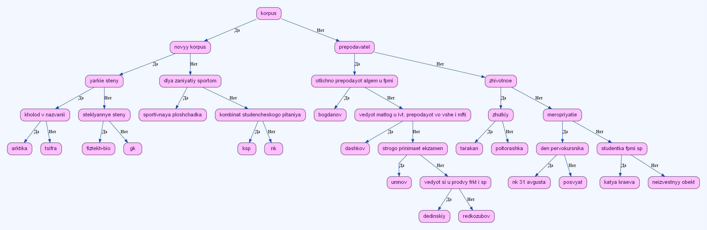

# Бинарное дерево

Проект реализует бинарное дерево с удобным сервисом графической отладки.
Проект написан на языке программирования СИ.
## Автор: Екатерина Краева
## Ментор: Павел Тараканов

## Компиляция и запуск
```
g++ -g -Wshadow -Winit-self -Wredundant-decls -Wcast-align -Wundef -Wfloat-equal -Winline -Wunreachable-code -Wmissing-declarations -Wmissing-include-dirs -Wswitch-enum -Wswitch-default -Weffc++ -Wmain -Wextra -Wall -g -pipe -fexceptions -Wcast-qual -Wconversion -Wctor-dtor-privacy -Wempty-body -Wformat-security -Wformat=2 -Wignored-qualifiers -Wlogical-op -Wno-missing-field-initializers -Wnon-virtual-dtor -Woverloaded-virtual -Wpointer-arith -Wsign-promo -Wstack-usage=8192 -Wstrict-aliasing -Wstrict-null-sentinel -Wtype-limits -Wwrite-strings -Werror=vla -D_DEBUG -D_EJUDGE_CLIENT_SIDE akinator.cpp -o akinator.exe
```
```
.\akinator.exe
```
## Сортировка чисел

Программа использует бинарное дерево для сортировки целых чисел.

## Акинатор

Реализована интерактивная консольная игра.
Есть несколько режимов, которые выбираются пользователем в меню.

### Угадать объект
Акинатор задаёт вопросы, на которые пользователь отвечает «да» или «нет». В зависимости от ответа программа переходит в левое или правое поддерево.

Если объект не удалось угадать, пользователь может добавить его в базу, указав его отличительный признак.

### Посмотреть общее дерево

Программа строит графическое представление бинарного дерева с помощью Graphviz.

### Получить определение объекта

Пользователь вводит название объекта, после чего программа находит его в дереве и выводит последовательность признаков, по которым можно его определить.


### Сравнить объекты

Программа находит два объекта в дереве и сравнивает их определения.

Результат содержит:
- общие признаки объектов
- признаки первого объекта
- признаки второго объекта

Для сравнения используется поиск ближайшего общего предка двух узлов.

### Завершить игру

Завершение работы программы с сохранением обновлённой базы объектов.

## Структура бинарного дерева
```
struct Node{
    NodeElem_t data;
    Node* left;
    Node* right;
    Node* parent;
};
struct BinaryTree_t{
    Node* root;
    size_t dim;
};
```

## Графика

Графическая реализация использует библиотеку ```Graphviz```.

Документация: https://www.graphviz.org/documentation/

Используемый гайд: https://lib.custis.ru/Graphviz

Картинки создаются командой ```dot graph.txt -Tpng -o binary-tree-picture.png``` через ```system```.

### Пример картинки дерева


## Структура проекта

|Файл|Назначение|
|:-|:-|
|binary-tree.h|Структуры данных, объявления функций и макросы|
|binary-tree.cpp|Операций с бинарным деревом|
|akinator.cpp|Игра АКИНАТОР|
|graphics.cpp|Построение графического представления дерева|
|akinator-tree.txt|Файл с сохранённой базой объектов|

## Говорилка

Присутствует озвучка игры на русском языке.
